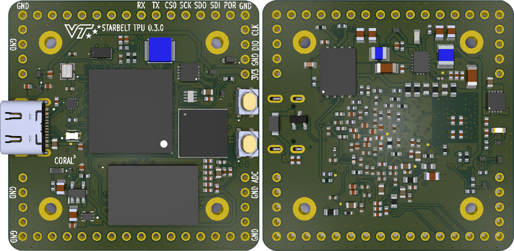

# TPU-Electricals

Open source hardware design for `sb-tpu`, a board embedding a Google Coral Edge TPU alongside an NXP i.MX RT1176 MCU, targeted at picosatellite payloads. Designed in [KiCad](https://www.kicad.org/) 10.

## Status

**0.3.0 is in layout and has not been fabricated.** It is a full respin of 0.2.1, with a new power system and a new 8-layer PCB. Treat it as a reference, not a validated product. See [Open Items](#open-items) before building.

## 0.3.0 Patch Notes

[docs/tpu-0_3_0.md](docs/tpu-0_3_0.md).

* **Power:** the LM3370 is replaced by an MPQ2166 (AEC-Q100, 2 A per channel). The 3V3 buck runs only from USB, and rail power bypasses it. 1V8 is RC-sequenced after 3V3, and its PG output holds `POR_B`. The `DCDC_IN` caps now return to GND.
* **Reset/boot:** watchdog removed, `DA_nONKEY` pull-up added, USB-C role strapped to UFP, tact switches changed to C&K PTS810.
* **TPU:** `PCIE_TX_N/P` changed from GND to no-connect.
* **PCB:** 8 layers (4 SIG / 3 GND / 1 split PWR), with power planes in place of trace-routed rails. Board-wide GND pours and stitching.
* **SDRAM:** re-routed with one byte lane per layer and via-in-pad. Lengths are matched.
* **USB/QSPI:** USB pair skew went from 2.33 mm to 0 mm. USB ESD went from 35 pF to 0.9 pF (TPD2E009). QSPI is length-matched.
* **Parts:** 65 passives derated to extended-temperature grades, plus automotive SDRAM. A full JLC/LCSC sourcing BOM has alternates.

## Open Items

* Fabrication at JLCPCB
* Board Bringup

Status of every item in the 0.2.1 design review is in [docs/tpu-0_3_0.md](docs/tpu-0_3_0.md#5-still-open). The review itself is [docs/tpu-issues.md](docs/tpu-issues.md).

## Directory Contents

* [bringup/](bringup/): bring-up validation scripts and captured logic-analyzer data for power sequencing (0.2.1 hardware)
* [docs/](docs/): release notes, design review and open-issue tracking
* [kicad/](kicad/): KiCad project, with schematics, PCB layout, libraries and manufacturing outputs

## License

Licensed under the [MIT License](LICENSE). Copyright (c) 2026 Jack Rathert.
