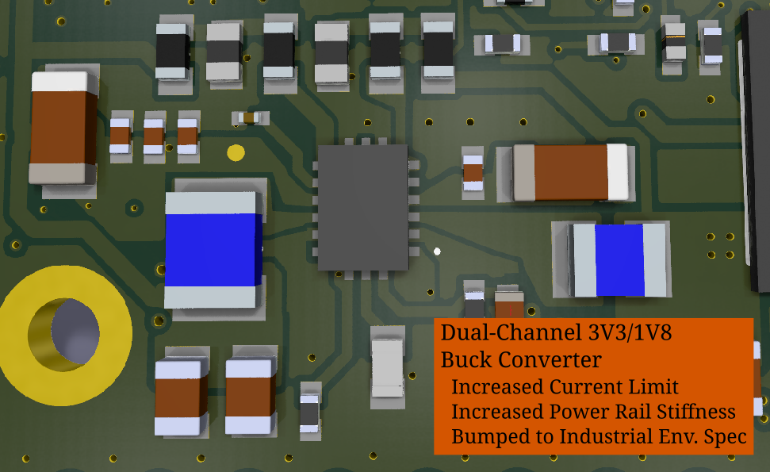
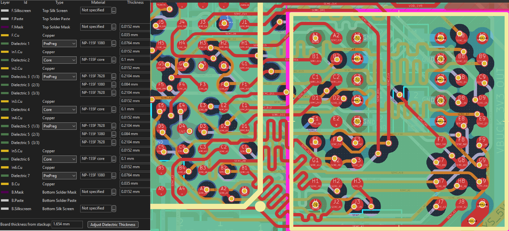

# `sb-tpu` 0.3.0 — What Changed

0.3.0 is a respin of the 0.2.1 board. It has a new power system, a new 8-layer layout, and
fixes for the bring-up failures catalogued in [tpu-issues.md](tpu-issues.md).
**Status:** layout is nearly complete and the board has not been fabricated yet.

## 1. Power

| | 0.2.1 | 0.3.0 |
|---|---|---|
| Buck | LM3370, 600 mA per channel, no soft-start on 3V3 | **MPQ2166**, AEC-Q100, 2 A per channel. 3V3 soft-start set by `C110` |
| 3V3 buck enable | Always on. In dropout on rail power, so `nPOR2` could reset the MCU | `EN1 = VSYS_5V`: runs **only from USB**. Rail power passes straight through `U1` |
| Sequencing | `EN1` RC only | 1V8 is RC-delayed off `VDD_3V3` (`R57`/`C99`, `D12` discharge). **PG2 holds `POR_B`** until 1V8 is in regulation |
| `MCU_DCDC_IN` caps | Returned to a floating net | Returned to `GND` |
| Watchdog `U5` | Re-asserted `POR_B` every 250 ms | Removed |
| USB-C role | `PORT` driven by an unpowered translator | Translator deleted. `PORT` strapped low by `R48` (UFP) |
| TPU on USB | Over budget, browns out the 3.3 V rail | 2 A of headroom on the 3V3 channel covers the MCU and TPU |

## 2. Reset, boot, TPU

* `DA_nONKEY` pull-up added (`R49`, 100 kΩ to `VDD_1V8`), so the button and boot node no
  longer float.
* Tact switches changed to C&K **PTS810**. The NO/COM terminal pairs are named in the symbol.
* Coral `PCIE_TX_N/P` (pins 4, 5) changed from shorted to GND to **no-connect**, matching Coral.

## 3. Layout

| Layer | F | In1 | In2 | In3 | In4 | In5 | In6 | B |
|---|---|---|---|---|---|---|---|---|
| Use | SIG | GND | SIG | PWR split | GND | SIG | GND | SIG |

* **Stackup:** 8 layers on JLC `JLC08161H-1080A`. Every signal layer is adjacent to a GND plane.
* **Power planes:** In3 carries a `VDD_1V8` base plane, with islands for `VDD_SOC_IN`,
  `MCM_3V3` and `SDRAM_1V8`. In 0.2.1, every rail was a 0.15 mm trace.
* **GND:** board-wide F/B pours, plus an edge fence and a 2.5 mm grid of about 205 stitching vias.
* **SDRAM:** all 39 SEMC nets were re-routed. Lane 1 is on F.Cu, lane 0 on In2, and
  address/control on In5. U7 uses via-in-pad. Length windows are enforced as DRC rules.
  The bus spread was 19.5 mm in 0.2.1.
* **USB:** `USB2_TPU` and OTG1 intra-pair skew went from 2.33 mm to **0 mm**. The connector
  leg is within ±1.13 mm for both plug orientations. ESD `D9` changed from PESD5V0S2BT (35 pF)
  to **TPD2E009** (0.9 pF).
* **QSPI:** data lines are 14.8–19.8 mm against a 16.1 mm CLK.
* **RT1176 decoupling:** 72 back-side passives were re-placed. Power and GND balls use
  via-in-pad, with B.Cu pours per rail.

## 4. Parts and reliability

* 65 passives were swapped to extended-temperature or higher-voltage parts. `C49` is the one
  remaining compromise, at 54 % voltage stress.
* The SDRAM is now the automotive `MT48H32M16LFB4-6 AAT`.
* Every BOM line now has an MPN, an LCSC number, approved alternates and sourcing notes. The
  JLC BOM is `kicad/production/sb-tpu-sourcing-bom.csv`.

## 5. Still open

| Item | Notes |
|---|---|

| TPU bulk caps | `C42`/`C43` are still about 20 mm from the `IC2` VIN pins. The In3 island carries the supply ([#7](tpu-issues.md)) |
| `POR_B` | Could maybe use some additional filters ([#6](tpu-issues.md)) |
| Availability | Some parts may need to be swapped for availability through JLCPCB or Global Order |